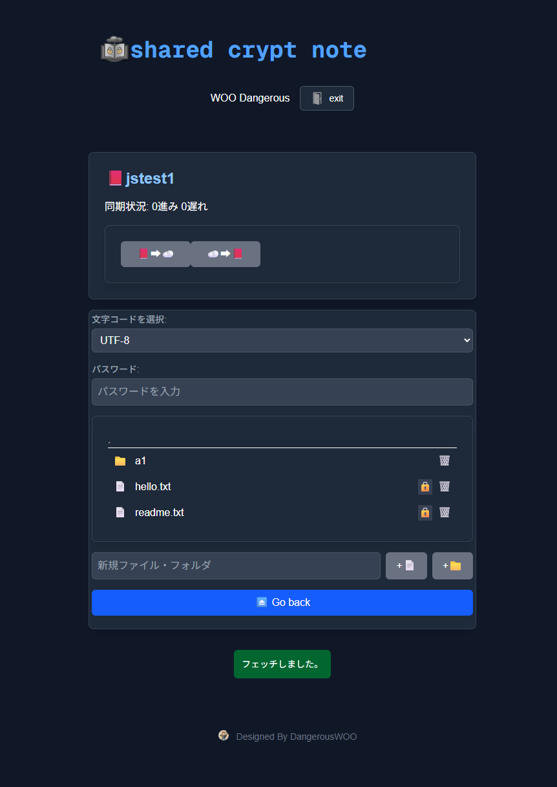

## SharedCryptNote
SharedCryptNote is a secure, web-based encrypted note-taking application. It uses the Blowfish encryption algorithm to securely store your notes and manages them efficiently within a file system. It is also compatible with the Android application "SharedKeyMemo," ensuring a seamless note-taking experience across your devices.

https://play.google.com/store/apps/details?id=org.dwmedia.sharedkeymemo



## Key Features
Strong Encryption

Uses the Blowfish algorithm to keep your notes safe and secure.

Google Account Integration

Easily log in using your existing Google account.

Git Version Control

Each note is managed with Git, allowing you to track changes and revert to previous versions.

Multi-Device Compatibility

Compatible with the Android app SharedKeyMemo, enabling you to share and edit the same notes between your PC and smartphone.

Tech Stack
Frontend: Next.js

Encryption: Blowfish

Version Control: Git

Authentication: Google Account Integration

## Google AUTH
.env.local
```bash
# NextAuth.js のセッションを暗号化するための秘密鍵です。任意の文字列で構いません。
NEXTAUTH_SECRET=UUID

# Google Cloud Platform で取得した Client ID
GOOGLE_CLIENT_ID=

# Google Cloud Platform で取得した Client Secret
GOOGLE_CLIENT_SECRET=

# Callback URL (http://localhost:3000/api/auth/callback/google)
NEXTAUTH_URL=https://sharednote.hoge.com
```

## Allow Users (ALLOWUSERS)
Restrict which Google accounts can sign in, using an allowlist.

- Set the `ALLOWUSERS` environment variable to the path of a JSON file listing allowed email addresses.
- When unset: no restriction (any Google account can sign in, as before).
- When set: only the listed addresses can sign in and use the APIs. Any other address is rejected at sign-in.
- Addresses are normalized with trim + lowercasing before comparison.
- Fail-closed: if the file is missing, unreadable, or contains broken JSON, everyone is rejected.
- New sign-ins are blocked in the `signIn` callback, and existing sessions are blocked with 403 in every API route.
- The file is reloaded when its mtime changes, so no restart is needed after editing.

```bash
# Add to .env.local
ALLOWUSERS=/git-repos/allowusers.json
```

JSON format (a plain array, or an object with a `users` / `allowedUsers` / `allowUsers` / `emails` key):

```json
[
  "you@example.com",
  "family@example.com"
]
```

```json
{ "users": ["you@example.com"] }
```

Setup example:

```bash
cat > /git-repos/allowusers.json <<EOF
[
  "you@example.com"
]
EOF
echo "ALLOWUSERS=/git-repos/allowusers.json" >> .env.local
npm run build
```

Note: `allowusers.json` in this repository is only a dummy sample (contains `your-email@gmail.com`). Replace it with your real address before use. If you do not want to push real addresses to Git, consider adding it to `.gitignore` or deploying it only on the server.

## Docker

It's easy to build with Docker.
Just get Google authentication and create a .env.local file.
Then it should be easy to start.

```bash
mkdir sharedcryptnote
cp Dockerfile sharedcryptnote/.
cp docker-compose.yml sharedcryptnote/.
cd sharedcryptnote
vi .env.local
docker compose up
```

## Getting Started
First, run the development server:

```bash
npm run dev
# or
yarn dev
# or
pnpm dev
# or
bun dev
```

Open [http://localhost:3000](http://localhost:3000) with your browser to see the result.

You can start editing the page by modifying `app/page.tsx`. The page auto-updates as you edit the file.

This project uses [`next/font`](https://nextjs.org/docs/app/building-your-application/optimizing/fonts) to automatically optimize and load [Geist](https://vercel.com/font), a new font family for Vercel.

## Learn More

To learn more about Next.js, take a look at the following resources:

- [Next.js Documentation](https://nextjs.org/docs) - learn about Next.js features and API.
- [Learn Next.js](https://nextjs.org/learn) - an interactive Next.js tutorial.

You can check out [the Next.js GitHub repository](https://github.com/vercel/next.js) - your feedback and contributions are welcome!

## Deploy on Vercel

The easiest way to deploy your Next.js app is to use the [Vercel Platform](https://vercel.com/new?utm_medium=default-template&filter=next.js&utm_source=create-next-app&utm_campaign=create-next-app-readme) from the creators of Next.js.

Check out our [Next.js deployment documentation](https://nextjs.org/docs/app/building-your-application/deploying) for more details.

